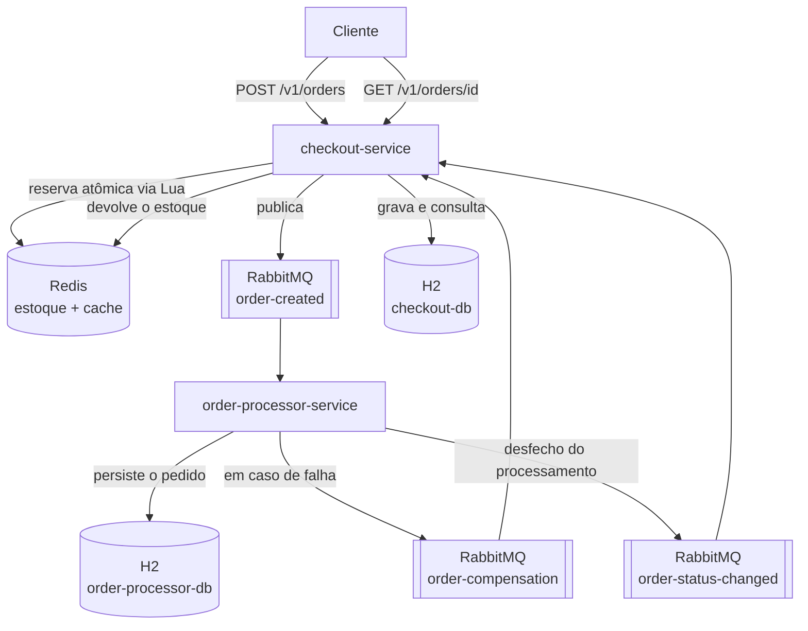

# Sistema de Checkout e Reserva de Estoque Relâmpago (Flash Sale)

Solução baseada em microsserviços para receber pedidos de uma promoção relâmpago, reservar estoque
de forma atômica no Redis, processar os pedidos de forma assíncrona via RabbitMQ e compensar a
reserva quando o processamento falha, aplicando uma **SAGA coreografada simplificada**.

- **Stack:** Java 21, Spring Boot 3.3.5, Maven (multi-módulo com wrapper `mvnw`)
- **Infraestrutura:** Redis 7, RabbitMQ 3.13, H2 em arquivo (uma base por serviço)
- **Microsserviços:** `checkout-service` (porta 8081) e `order-processor-service` (porta 8082)

---

## 1. Arquitetura



### Decisões de projeto

**Reserva atômica com script Lua.** Durante uma queima de estoque, milhares de requisições
concorrem pelo mesmo produto. Um par `GET` + `DECRBY` executado na aplicação abriria uma janela
para duas requisições lerem o mesmo saldo e venderem a mesma unidade duas vezes. O Redis executa
cada script Lua atomicamente, então leitura e decremento acontecem sem interrupção, e o estoque
nunca fica negativo. Há um teste de concorrência que dispara 30 pedidos simultâneos sobre 5
unidades e verifica que exatamente 5 são aceitos.

**Terceira fila `order-status-changed`.** O escopo obrigatório pede duas filas, e ambas estão
implementadas exatamente como especificado. Porém, como cada serviço tem sua própria base e o
Checkout nunca lê a base do Order Processor, o Checkout não teria como saber que um pedido chegou
a `CONFIRMED` — e o `GET /v1/orders/{pedido_id}` precisa devolver esse status. A fila
`order-status-changed` resolve isso com *event-carried state transfer*: o Order Processor publica
o desfecho e o Checkout atualiza sua própria base e seu cache. A alternativa seria o Checkout
consultar o banco do outro serviço, o que quebraria a segregação de bases exigida pelo projeto.

**Idempotência em todos os consumidores.** O RabbitMQ pode reentregar mensagens. A devolução de
estoque é protegida por uma chave `compensation:{pedido_id}` gravada com `SETNX` no Redis, então
o saldo nunca é incrementado duas vezes pela mesma falha. No Order Processor, pedidos já em estado
final não são reprocessados. No Checkout, um `CONFIRMED` atrasado não sobrescreve um `CANCELLED`.

**Portas e adaptadores.** As regras de negócio dependem de interfaces (`StockPort`,
`OrderCachePort`, `OrderEventPublisherPort`, `OrderRepositoryPort`). Em produção os adaptadores
são Redis, RabbitMQ e JPA; nos testes são implementações em memória ativadas pelo perfil `test`.
Isso é o que permite rodar a suíte inteira sem nenhuma infraestrutura externa.

**Rollback local na criação do pedido.** Se a reserva no Redis funcionar mas a gravação ou a
publicação falhar, o pedido nunca chega à fila e nenhum consumidor vai compensá-lo. Nesse caso o
próprio caso de uso devolve o estoque imediatamente, antes de propagar o erro.

---

## 2. Estrutura do projeto

```
flash-sale-checkout/
├── pom.xml                        # POM pai (agregador dos dois módulos)
├── docker-compose.yml             # Redis, RabbitMQ e os dois serviços
├── mvnw / mvnw.cmd                # Maven Wrapper (não exige Maven instalado)
├── scripts/
│   ├── smoke-test.sh              # sobe a stack, aguarda saúde e roda a demo
│   ├── demo.sh                    # roteiro de demonstração (bash)
│   ├── demo.ps1                   # roteiro de demonstração (PowerShell)
│   └── inspect.sh                 # filas do RabbitMQ, chaves do Redis e logs da SAGA
│
├── checkout-service/
│   ├── Dockerfile                 # multi-stage: maven:3.9-eclipse-temurin-21 -> temurin:21-jre
│   └── src/main/java/com/marketplace/checkout/
│       ├── api/                   # OrderController, StockController, DTOs, tratamento de erro
│       ├── application/           # CreateOrder, GetOrder, CompensateOrder, ApplyOrderStatus
│       ├── config/                # CheckoutProperties, bean de Clock
│       ├── domain/
│       │   ├── model/             # CustomerOrder (agregado), OrderStatus
│       │   ├── exception/         # InvalidOrder, InsufficientStock, OrderNotFound
│       │   └── port/              # StockPort, OrderCachePort, OrderEventPublisherPort, ...
│       └── infrastructure/
│           ├── redis/             # RedisStockAdapter (script Lua), RedisOrderCacheAdapter
│           ├── messaging/         # producer order-created + consumers das filas de retorno
│           ├── persistence/       # entidade JPA e adaptador do repositório
│           └── stock/             # carga inicial do estoque
│
└── order-processor-service/
    ├── Dockerfile
    └── src/main/java/com/marketplace/orderprocessor/
        ├── api/                   # consulta interna e ajuste da falha simulada em runtime
        ├── application/           # ProcessOrderUseCase e mensagens da SAGA
        ├── config/                # ProcessorProperties, bean de Clock
        ├── domain/
        │   ├── model/             # ProcessedOrder (agregado), OrderStatus
        │   ├── service/           # FailureSimulator (falha configurável)
        │   └── port/              # repositório e publisher da SAGA
        └── infrastructure/
            ├── messaging/         # consumer order-created + publishers de retorno
            └── persistence/       # entidade JPA e adaptador do repositório
```

Cada serviço tem **sua própria base H2**: `checkout-db` e `order-processor-db`. Nenhum dos dois
acessa a base do outro; toda a comunicação acontece por mensagens.

---

## 3. Pré-requisitos

Para rodar **tudo via Docker** (caminho recomendado, não exige Java instalado):

- Docker e Docker Compose

Para rodar os **serviços localmente** com a infraestrutura no Docker:

- JDK 21
- Docker e Docker Compose (para Redis e RabbitMQ)
- Maven **não** é necessário: use o wrapper `./mvnw`

### Observação para Windows com Docker dentro do WSL

Se o `docker` não existir no PATH do Windows mas estiver instalado dentro de uma distro WSL,
prefixe os comandos com `wsl -e`. O WSL 2 faz *localhost forwarding*, então as portas publicadas
pelos containers ficam acessíveis em `localhost` no Windows normalmente.

```powershell
# Windows + Docker no WSL
wsl -e bash -lc 'cd /mnt/c/Users/<usuario>/Projects/flash-sale-checkout && docker compose up -d'
```

> O WSL encerra a distro quando ela fica ociosa, o que para os containers. Se isso acontecer,
> basta rodar `docker compose up -d` novamente. Para encadear vários comandos, agrupe-os em uma
> única invocação do `wsl` (é o que os scripts em `scripts/` fazem).

Em Linux, macOS ou com Docker Desktop no PATH do Windows, use os mesmos comandos **sem** o
prefixo `wsl -e`.

---

## 4. Como executar

### Opção A — Tudo via Docker Compose (sem JDK local)

Sobe Redis, RabbitMQ e os dois microsserviços. As imagens são construídas em multi-stage, então
o Maven e o JDK rodam dentro do container de build.

```bash
docker compose up -d --build

# acompanhar a inicialização
docker compose logs -f checkout-service order-processor-service
```

No Windows com Docker no WSL:

```powershell
wsl -e bash -lc 'cd /mnt/c/Users/<usuario>/Projects/flash-sale-checkout && docker compose up -d --build'
```

Para parar:

```bash
docker compose down          # mantém os volumes (estoque e bases)
docker compose down -v       # remove os volumes e zera o estado
```

### Opção B — Infraestrutura via Docker + serviços via Maven

Útil para desenvolver com debug e hot reload na IDE.

```bash
# 1. somente a infraestrutura
docker compose up -d redis rabbitmq

# 2. em um terminal
./mvnw -pl checkout-service spring-boot:run

# 3. em outro terminal
./mvnw -pl order-processor-service spring-boot:run
```

No Windows (PowerShell), use `.\mvnw.cmd` e prefixe apenas o comando do Docker:

```powershell
wsl -e bash -lc 'cd /mnt/c/Users/<usuario>/Projects/flash-sale-checkout && docker compose up -d redis rabbitmq'
.\mvnw.cmd -pl checkout-service spring-boot:run
.\mvnw.cmd -pl order-processor-service spring-boot:run
```

Os serviços leem `REDIS_HOST`, `RABBITMQ_HOST` e afins do ambiente, com `localhost` como padrão —
é exatamente o que o localhost forwarding do WSL 2 entrega.

### Endereços

| Recurso | URL |
|---|---|
| checkout-service | http://localhost:8081 |
| order-processor-service | http://localhost:8082 |
| Painel do RabbitMQ | http://localhost:15672 (`guest` / `guest`) |
| Console H2 do checkout | http://localhost:8081/h2-console |
| Console H2 do processor | http://localhost:8082/h2-console |
| Health checks | `/actuator/health` em cada serviço |

No console H2, use a JDBC URL que aparece no log de inicialização do serviço, usuário `sa` e
senha vazia.

---

## 5. API

### `POST /v1/orders` — criar pedido

```bash
curl -X POST http://localhost:8081/v1/orders \
  -H 'Content-Type: application/json' \
  -d '{
    "produto_id": "PROD-001",
    "quantidade": 2,
    "cliente_cpf": "50329291076",
    "cliente_nome": "Fernando Augusto"
  }'
```

`202 Accepted` — estoque reservado e pedido publicado em `order-created`:

```json
{
  "pedido_id": "b819cc65-f6f0-478c-8bb7-69ee1c4f6402",
  "status": "PROCESSING",
  "data_hora_requisicao": "2026-09-07T20:03:57"
}
```

`409 Conflict` — saldo insuficiente (ou produto sem estoque cadastrado); nada é decrementado:

```json
{ "mensagem": "Estoque insuficiente para o produto PROD-001" }
```

`400 Bad Request` — validação de entrada (`produto_id` obrigatório, `quantidade` maior que zero,
`cliente_cpf` obrigatório com 11 dígitos):

```json
{ "mensagem": "A quantidade deve ser maior que zero" }
```

### `GET /v1/orders/{pedido_id}` — consultar pedido

Usa **Cache-Aside**: busca no Redis; em caso de miss, consulta a base do Checkout, grava o
resultado no cache com TTL de 5 minutos e devolve. São feitas **até 3 tentativas** antes do 404,
porque a criação responde `202` antes do processamento terminar.

```bash
curl http://localhost:8081/v1/orders/b819cc65-f6f0-478c-8bb7-69ee1c4f6402
```

`200 OK`:

```json
{
  "pedido_id": "b819cc65-f6f0-478c-8bb7-69ee1c4f6402",
  "produto_id": "PROD-001",
  "quantidade": 2,
  "cliente_cpf": "50329291076",
  "cliente_nome": "Fernando Augusto",
  "status": "CONFIRMED",
  "data_hora_atualizacao": "2026-09-07T20:04:10"
}
```

`404 Not Found`:

```json
{ "mensagem": "Pedido não encontrado" }
```

### Endpoints auxiliares

Não fazem parte do contrato do cliente final; existem para preparar e inspecionar a demonstração.

| Método e rota | Serviço | Função |
|---|---|---|
| `GET /v1/stock/{produto_id}` | checkout | Saldo disponível no Redis |
| `PUT /v1/stock/{produto_id}?quantidade=N` | checkout | Define o saldo do produto |
| `GET /internal/orders` | processor | Lista os pedidos da base do processor |
| `GET /internal/orders/{pedido_id}` | processor | Consulta um pedido na base do processor |
| `GET /internal/failure-mode` | processor | Configuração atual da falha simulada |
| `POST /internal/failure-mode` | processor | Ajusta a falha simulada em runtime |

---

## 6. Filas e mensagens

| Fila | Publicada por | Consumida por |
|---|---|---|
| `order-created` | checkout-service | order-processor-service |
| `order-compensation` | order-processor-service | checkout-service |
| `order-status-changed` | order-processor-service | checkout-service |

As mensagens trafegam em JSON com nomes em `snake_case`, pelo exchange padrão usando o nome da
fila como routing key. As filas são duráveis e declaradas pelos dois serviços, então eles podem
subir em qualquer ordem.

`order-created`:

```json
{
  "pedido_id": "b819cc65-f6f0-478c-8bb7-69ee1c4f6402",
  "produto_id": "PROD-001",
  "quantidade": 2,
  "cliente_cpf": "50329291076",
  "cliente_nome": "Fernando Augusto",
  "data_hora_criacao": "2026-09-07T20:03:57"
}
```

`order-compensation`:

```json
{
  "pedido_id": "b819cc65-f6f0-478c-8bb7-69ee1c4f6402",
  "produto_id": "PROD-001",
  "quantidade": 2,
  "motivo": "Falha no processamento do pedido"
}
```

### Chaves no Redis

| Chave | Conteúdo |
|---|---|
| `stock:{produto_id}` | Saldo disponível do produto |
| `order:{pedido_id}` | Pedido serializado em JSON, TTL de 5 minutos |
| `compensation:{pedido_id}` | Marca de idempotência da compensação, TTL de 1 dia |

---

## 7. SAGA coreografada

### Fluxo de sucesso

1. Cliente chama `POST /v1/orders`.
2. Checkout reserva o estoque no Redis (script Lua, atômico).
3. Checkout grava o pedido como `PROCESSING` na sua base e publica em `order-created`.
4. Cliente recebe `202 Accepted` — sem esperar o processamento.
5. Order Processor consome `order-created` e persiste o pedido na sua própria base.
6. Pedido recebe status `CONFIRMED`; o desfecho é publicado em `order-status-changed`.
7. Checkout atualiza sua base e seu cache; o `GET` passa a responder `CONFIRMED`.

### Fluxo de falha e compensação

1. Passos 1 a 5 iguais ao fluxo de sucesso.
2. Ocorre falha na persistência ou na regra de processamento.
3. Order Processor marca o pedido como `CANCELLED` na sua base.
4. Order Processor publica em `order-compensation` com produto, quantidade e motivo.
5. Checkout consome a compensação e devolve a quantidade ao estoque no Redis (uma única vez).
6. Checkout marca o pedido como `CANCELLED` na sua base e atualiza o cache.

---

## 8. Simulação de falha

O "pagamento" é representado por uma falha configurável, com três gatilhos avaliados em conjunto
(basta um ser satisfeito para o pedido falhar):

| Propriedade | Padrão | Efeito |
|---|---|---|
| `processor.failure.enabled` | `true` | Liga ou desliga toda a simulação |
| `processor.failure.product-ids` | `[PROD-FAIL]` | Produtos que sempre falham |
| `processor.failure.quantity-above` | `0` (desligado) | Falha quando a quantidade excede o valor |
| `processor.failure.rate` | `0.0` | Probabilidade de falha aleatória, de 0.0 a 1.0 |

Por padrão, **qualquer pedido de `PROD-FAIL` cai no fluxo de compensação** — é o cenário
determinístico usado na demonstração. Para ajustar sem reiniciar o serviço:

```bash
# todo pedido passa a falhar
curl -X POST 'http://localhost:8082/internal/failure-mode?rate=1.0'

# volta ao normal, mantendo apenas PROD-FAIL como produto que falha
curl -X POST 'http://localhost:8082/internal/failure-mode?rate=0.0'

# desliga a simulação por completo
curl -X POST 'http://localhost:8082/internal/failure-mode?enabled=false'
```

---

## 9. Roteiro de demonstração

Os scripts cobrem os 12 passos do roteiro mínimo de ponta a ponta.

```bash
# sobe a stack, aguarda os health checks e executa a demonstração completa
./scripts/smoke-test.sh

# apenas a demonstração, com a stack já no ar
./scripts/demo.sh

# filas no RabbitMQ, chaves no Redis e as linhas de log de cada passo da SAGA
./scripts/inspect.sh
```

No Windows com Docker no WSL:

```powershell
wsl -e bash scripts/smoke-test.sh
wsl -e bash scripts/inspect.sh

# versão PowerShell da demonstração (com a stack já no ar)
.\scripts\demo.ps1
```

### Passo a passo manual

```bash
# 1. estoque inicial
curl http://localhost:8081/v1/stock/PROD-001

# 2-3. cria o pedido e recebe 202 com o pedido_id
curl -X POST http://localhost:8081/v1/orders -H 'Content-Type: application/json' \
  -d '{"produto_id":"PROD-001","quantidade":2,"cliente_cpf":"50329291076","cliente_nome":"Fernando Augusto"}'

# 4. estoque já reservado (baixou 2 unidades)
curl http://localhost:8081/v1/stock/PROD-001

# 5-6. pedido persistido pelo processor com status CONFIRMED
curl http://localhost:8082/internal/orders/<pedido_id>

# 7-8. consulta pública no checkout, servida pelo cache no Redis
curl http://localhost:8081/v1/orders/<pedido_id>

# 9-12. cenário de falha: reserva, compensação e devolução do estoque
curl http://localhost:8081/v1/stock/PROD-FAIL
curl -X POST http://localhost:8081/v1/orders -H 'Content-Type: application/json' \
  -d '{"produto_id":"PROD-FAIL","quantidade":3,"cliente_cpf":"50329291076","cliente_nome":"Fernando Augusto"}'
curl http://localhost:8081/v1/stock/PROD-FAIL   # saldo voltou ao valor original
curl http://localhost:8081/v1/orders/<pedido_id> # status CANCELLED
```

A publicação e o consumo das mensagens podem ser acompanhados no painel do RabbitMQ
(http://localhost:15672) e nos logs, que registram cada passo da SAGA.

---

## 10. Testes

```bash
# suíte completa dos dois módulos
./mvnw test

# somente um módulo
./mvnw -pl checkout-service test
./mvnw -pl order-processor-service test
```

No Windows (PowerShell): `.\mvnw.cmd test`.

Sem JDK local, rode a suíte dentro de um container:

```bash
docker run --rm -v "$PWD":/app -w /app maven:3.9-eclipse-temurin-21 mvn -B test
```

Os testes **não precisam de Redis nem de RabbitMQ**: o perfil `test` substitui esses adaptadores
por implementações em memória e desliga as auto-configurações correspondentes. O H2 roda em
memória.

### Cobertura

**Testes unitários das regras de negócio** (`checkout-service`, 32 testes)

- `CustomerOrderTest` — invariantes do agregado: produto obrigatório, quantidade positiva, CPF
  obrigatório e normalizado, geração de UUID v4, transições de status.
- `CreateOrderUseCaseTest` — sucesso, saldo insuficiente, produto inexistente, validação antes de
  tocar o estoque e devolução imediata da reserva quando a gravação ou a publicação falha.
- `GetOrderUseCaseTest` — cache hit, cache miss com repovoamento e TTL de 5 minutos, exatamente
  três tentativas antes do erro e sucesso quando o pedido aparece na terceira tentativa.
- `CompensateOrderUseCaseTest` — devolução do estoque com transição para `CANCELLED`,
  idempotência em caso de reentrega e devolução mesmo sem o pedido na base local.
- `ApplyOrderStatusUseCaseTest` — aplicação de `CONFIRMED` e proteção do estado final `CANCELLED`.

**Testes unitários das regras de negócio** (`order-processor-service`, 10 testes)

- `ProcessOrderUseCaseTest` — confirmação, falha de regra publicando compensação com produto e
  quantidade corretos, falha de persistência também disparando compensação e não reprocessamento
  de pedidos já finalizados.
- `ConfigurableFailureSimulatorTest` — cada gatilho da falha simulada.

**Testes de integração dos fluxos principais** (15 testes)

- `CheckoutFlowIntegrationTest` — contexto completo com web e JPA. Cobre `202` com reserva e
  publicação, `409` sem estoque, `400` de validação, consulta pelo cache, consulta pelo banco com
  repovoamento do cache, `404` após três tentativas, SAGA de sucesso até `CONFIRMED`, SAGA de
  compensação até `CANCELLED` com estoque devolvido, compensação reentregue sem duplicar estoque
  e **um cenário de concorrência com 30 pedidos simultâneos sobre 5 unidades**, que verifica que
  exatamente 5 são aceitos e o saldo termina em zero.
- `OrderProcessorFlowIntegrationTest` — persistência com `CONFIRMED`, `CANCELLED` com publicação
  da compensação, gatilho de quantidade configurado em runtime, idempotência de reentrega e
  consulta interna.

### Nota sobre o Mockito

Cada módulo tem um arquivo `src/test/resources/mockito-extensions/org.mockito.plugins.MockMaker`
configurando `mock-maker-subclass`. O mock maker padrão (inline) instala um agente Java fazendo
*self-attach* na JVM em execução, o que falha em containers e em algumas configurações de CI.
Todos os dublês da suíte são interfaces (as portas do domínio), então o mock maker por subclasse
atende sem perda de funcionalidade e torna os testes portáveis.

---

## 11. Configuração

Valores padrão em `src/main/resources/application.yml` de cada serviço, sobrescrevíveis por
variáveis de ambiente.

### checkout-service

| Propriedade | Variável | Padrão |
|---|---|---|
| Porta HTTP | `CHECKOUT_PORT` | `8081` |
| Host do Redis | `REDIS_HOST` | `localhost` |
| Host do RabbitMQ | `RABBITMQ_HOST` | `localhost` |
| Caminho da base H2 | `CHECKOUT_DB_PATH` | `./data/checkout-db` |
| Recriar estoque ao subir | `CHECKOUT_RESET_STOCK` | `false` |
| `checkout.cache-ttl` | — | `5m` |
| `checkout.query-attempts` | — | `3` |
| `checkout.query-retry-delay` | — | `200ms` |
| `checkout.initial-stock` | — | `PROD-001: 10`, `PROD-002: 50`, `PROD-FAIL: 25` |

A carga inicial do estoque usa `SETNX`, então reiniciar o serviço **não** apaga o saldo de uma
venda em andamento. Para forçar o valor configurado a cada inicialização, use
`CHECKOUT_RESET_STOCK=true`.

### order-processor-service

| Propriedade | Variável | Padrão |
|---|---|---|
| Porta HTTP | `PROCESSOR_PORT` | `8082` |
| Host do RabbitMQ | `RABBITMQ_HOST` | `localhost` |
| Caminho da base H2 | `PROCESSOR_DB_PATH` | `./data/order-processor-db` |
| `processor.processing-delay` | — | `0ms` |
| `processor.failure.*` | — | ver seção 8 |

Aumentar `processor.processing-delay` (por exemplo para `3s`) deixa o status `PROCESSING`
observável durante a apresentação, entre o `202` e a confirmação.

### Perfis

| Perfil | Uso |
|---|---|
| *(padrão)* | Execução local: Redis, RabbitMQ e H2 em `localhost` / arquivo |
| `docker` | Execução no compose: hosts `redis` e `rabbitmq`, H2 em `/app/data` |
| `test` | Suíte automatizada: adaptadores em memória, H2 em memória |

---

## 12. Mapeamento dos requisitos

| Competência | Onde está implementada |
|---|---|
| DDD | Domínios separados, agregados `CustomerOrder` e `ProcessedOrder`, camadas `domain` / `application` / `infrastructure` / `api` |
| Microsserviços | `checkout-service` e `order-processor-service`, independentes e com portas próprias |
| Banco segregado | Bases H2 distintas; nenhum serviço acessa a base do outro |
| Redis | `RedisStockAdapter` (estoque) e `RedisOrderCacheAdapter` (cache de consulta) |
| Cache-Aside | `GetOrderUseCase`: Redis, depois banco, depois repovoamento com TTL de 5 min |
| RabbitMQ | Comunicação assíncrona pelas três filas |
| Producer e Consumer | `RabbitOrderEventPublisher`, `RabbitSagaEventPublisher`, `OrderCreatedListener`, `OrderCompensationListener`, `OrderStatusChangedListener` |
| SAGA | `ProcessOrderUseCase` publica a compensação; `CompensateOrderUseCase` devolve o estoque |
| Retry | `checkout.query-attempts: 3` com intervalo configurável antes do `404` |
| Testes | 57 testes: unitários das regras de negócio e de integração dos fluxos principais |

### Escopo obrigatório (MVP)

- [x] Dois microsserviços: `checkout-service` e `order-processor-service`
- [x] `POST /v1/orders`
- [x] Validação dos dados recebidos
- [x] Redis para consultar e reservar estoque
- [x] Estoque nunca decrementado abaixo de zero (script Lua + teste de concorrência)
- [x] Publicação na fila `order-created`
- [x] Consumo da fila no `order-processor-service`
- [x] Persistência do pedido em banco de dados
- [x] Fila `order-compensation`
- [x] Devolução do estoque reservado em caso de falha
- [x] `GET /v1/orders/{pedido_id}`
- [x] Cache-Aside com Redis e TTL de 5 minutos
- [x] Três tentativas antes do `404 Not Found`
- [x] Testes dos principais casos de sucesso e falha
- [x] `README.md` com instruções de execução

---

## 13. Problemas comuns

**Os serviços sobem mas não conectam no Redis ou no RabbitMQ.** Em execução local, confirme que a
infraestrutura está no ar (`docker compose ps`). No Windows com Docker no WSL, verifique se a
distro não foi encerrada por inatividade; nesse caso os containers param e basta rodar
`docker compose up -d` novamente.

**`Estoque insuficiente` mesmo com saldo aparente.** O produto pode não ter estoque cadastrado no
Redis — produto inexistente também responde `409`. Confira com
`GET /v1/stock/{produto_id}` e defina o saldo com `PUT /v1/stock/{produto_id}?quantidade=N`.

**O `GET` devolve `404` logo após o `POST`.** O processamento é assíncrono. As três tentativas
cobrem o intervalo normal, mas se `processor.processing-delay` estiver alto, aumente
`checkout.query-attempts` ou `checkout.query-retry-delay`.

**Erros de `\r` ao executar os scripts.** Os arquivos `.sh` precisam de fim de linha LF. O
`.gitattributes` do repositório já garante isso; se um editor converter para CRLF, rode
`sed -i 's/\r$//' scripts/*.sh`.

**Quero zerar todo o estado.** `docker compose down -v` remove os volumes do Redis, do RabbitMQ e
das bases H2.
